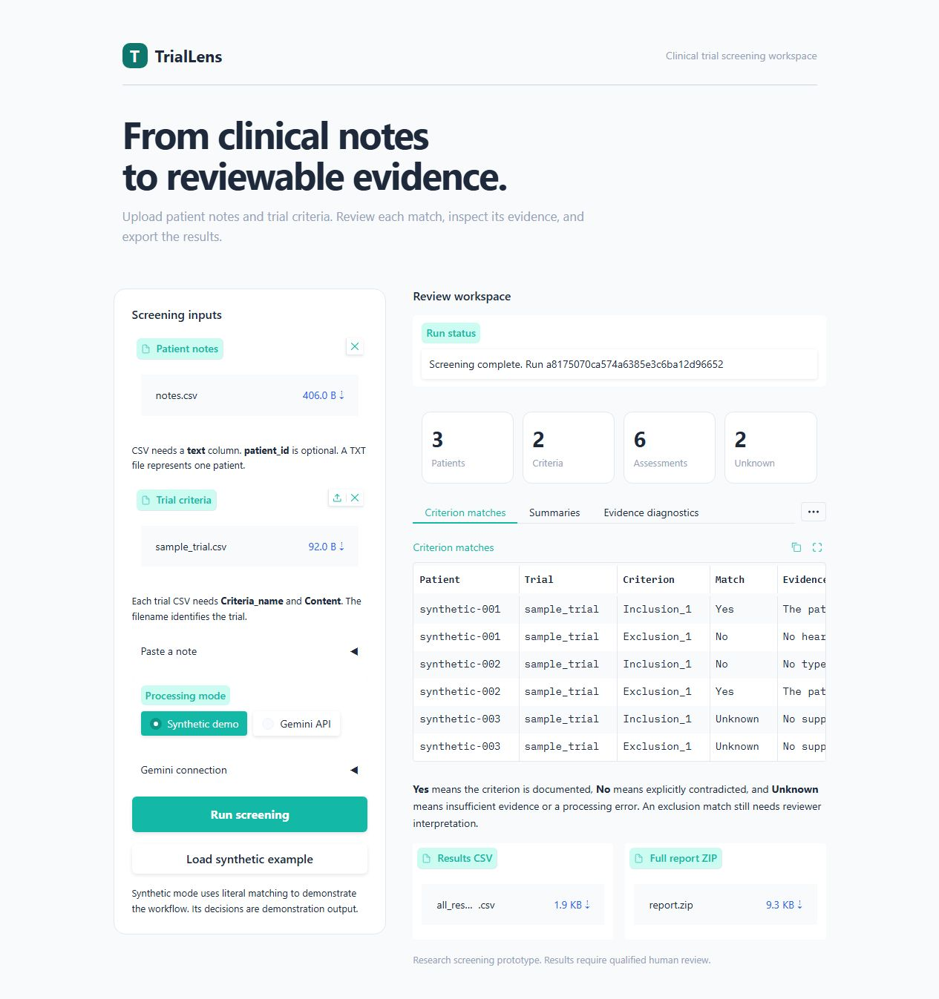

<div align="center">

# TrialLens

**From clinical notes to reviewable trial evidence.**

Upload notes and trial criteria, inspect criterion-level matches, and download a complete screening report.


[Launch locally](#launch-the-workspace) · [Input formats](#upload-formats) · [Architecture](docs/ARCHITECTURE.md) · [Notebook migration](docs/MIGRATION.md)



</div>

## A complete screening workspace

| Upload | Review | Export |
| --- | --- | --- |
| Patient notes as CSV or TXT | One result per patient and trial criterion | Consolidated results CSV |
| One or more trial criteria CSVs | Exact evidence quotations and short justifications | Full report ZIP with JSON and per-criterion CSVs |
| Optional pasted note | Summaries, retrieval chunks, and evidence diagnostics | Run metadata and completion status |

TrialLens is the Python application version of this repository's clinical trial eligibility capstone. The workflow retains Gemini, LangGraph, ChromaDB, SQLite, and a Gradio interface. It runs through the same implementation from the UI, CLI, and Python API.

## Launch the workspace

Use Python 3.10 or newer.

```bash
git clone https://github.com/Mahsatajik/GenAI.git
cd GenAI
python -m venv .venv
# Linux / macOS
source .venv/bin/activate
# Windows PowerShell
# .venv\Scripts\Activate.ps1

python -m pip install -e ".[ui]"
trial-screen serve --demo
```

Open **http://127.0.0.1:7860**. Select **Load synthetic example**, then **Run screening**. The bundled examples contain three fictional patients and two criteria.

Synthetic mode uses deterministic literal matching and hashed token embeddings. It exercises file loading, LangGraph execution, patient-scoped Chroma retrieval, SQLite storage, evidence checks, and report export without external API requests. Its output demonstrates the workflow.

## Use Gemini

In the workspace, select **Gemini API** and open **Gemini connection**. Enter your API key, generation model ID, and embedding model ID. Alternatively, export these environment variables before launching the app.

```bash
export GEMINI_API_KEY="your-key"
export GEMINI_MODEL="a-generation-model-available-to-your-account"
export GEMINI_EMBEDDING_MODEL="an-embedding-model-available-to-your-account"
trial-screen serve
```

On PowerShell, use the form **$env:GEMINI_API_KEY="your-key"**. The SDK also accepts **GOOGLE_API_KEY**. Model IDs are configurable because model availability changes. An optional **GEMINI_SUMMARY_MODEL** selects a pre-existing tuned model for summarization. Fine-tuning is a separate activity.

The UI key field is password-masked. Keys are passed to the request client and are not written to application reports. Gemini mode sends the uploaded note content and criteria to Google. Use data you are authorized to process with the configured provider.

## Upload formats

**Patient notes CSV**

```csv
patient_id,text
example-001,"This is a fictional example. The patient has type 2 diabetes."
example-002,"This is a fictional example. The patient has a sprained ankle."
```

A **text** column is required. **patient_id** is optional and generated when omitted. Supplied IDs must be unique within a run. Blank note rows are skipped. A UTF-8 **TXT** file is treated as one patient. A pasted note can accompany an uploaded file.

**Trial criteria CSV**

```csv
Criteria_name,Content
Inclusion_1,type 2 diabetes
Exclusion_1,heart failure hospitalization
```

Each filename identifies a trial. Criterion names must be unique within that trial. Names beginning with **Inclusion_** or **Exclusion_** retain that criterion type; other names are supported with an unspecified type. The same name can appear in different trials.

The original notebook's **text**, **Criteria_name**, and **Content** CSV columns remain supported. Downloadable examples live in [src/clinical_trials/examples](src/clinical_trials/examples).

## Read the results

- **Yes** means that the individual criterion is documented in the patient's record.
- **No** means the criterion is explicitly contradicted.
- **Unknown** means documentation is insufficient, evidence validation failed, or processing failed.

A **Yes** for an exclusion criterion means that exclusion is present. The application produces criterion-level screening results. Overall trial enrollment decisions require qualified review.

Evidence quotations are checked against the original note for that patient. Retrieval and reverse retrieval are restricted to the same patient's chunks. ROUGE, fuzzy matching, and cosine similarity describe evidence alignment with retrieved summaries; they do not measure clinical accuracy.

## Command-line usage

```bash
# Bundled synthetic experiment
trial-screen demo --output-dir outputs/demo

# Live screening with CSV files and environment configuration
trial-screen run --notes notes.csv --criteria trials/ --output-dir outputs/live

# Control retrieval
trial-screen run --notes notes.csv --criteria trials/ --chunk-size 450 --chunk-overlap 50 --top-k 5
```

Every invocation gets its own run directory and vector index.

```text
outputs/
  clinical_data.db
  runs/<run-id>/
    run.json
    summaries.json
    criteria.json
    eligibility.json
    chunks.json
    chromadb/
    evaluation/
      all_results.csv
      <trial>/<criterion>.csv
    report.zip
```

SQLite records use a composite run/patient key. Reports distinguish failed and partially completed runs. The ZIP contains CSV and JSON artifacts. It excludes the vector database. Exported reports contain the submitted clinical content.

## Python API

```python
from pathlib import Path

from clinical_trials.config import Settings
from clinical_trials.data import read_criteria, read_notes
from clinical_trials.pipeline import run_pipeline
from clinical_trials.providers import GeminiProvider

settings = Settings.from_env(output_dir=Path("outputs"))
provider = GeminiProvider(settings)
try:
    result = run_pipeline(
        read_notes(Path("notes.csv")),
        read_criteria(Path("trials")),
        settings,
        provider,
    )
    print(result.csv_path)
finally:
    provider.close()
```

## Project structure

```text
src/clinical_trials/
  cli.py          CLI commands and runtime configuration
  config.py       Validated settings
  models.py       Typed patient, criterion, and result records
  data.py         CSV input and artifact writers
  providers.py    Gemini integration and synthetic demo provider
  retrieval.py    Chunking and patient-scoped Chroma retrieval
  storage.py      SQLite persistence and safe output names
  evaluation.py   Evidence validation and alignment diagnostics
  pipeline.py     Shared LangGraph workflow
  ui.py           Upload, review, and download workspace
  assets/         UI styling
  examples/       Fictional input files
tests/            Identity, retrieval, evidence, storage, and upload checks
docs/             Architecture, migration, and product screenshots
```

## Development

```bash
python -m pip install -e ".[ui,dev]"
ruff check src tests
python -m unittest discover -s tests -v
python -m build
```

CI exercises Python 3.10 and 3.12, runs the synthetic pipeline, and builds distributable packages. Live Gemini behavior additionally requires credentials and a model available to the account.

This is a local research prototype. Clinical validation, deployment authentication, and multi-user access controls are outside the current implementation. MIMIC-IV data is not bundled; obtain access through its original provider.

## Authors and original project

Developed by [Mehrnoosh Azizi](https://www.linkedin.com/in/mehrnoosh-azizi/), [Reza Rezaeian](https://www.linkedin.com/in/reza-rezaeian/), and [Mahsa Tajik](https://www.linkedin.com/in/mahsa-tajik/).

The [original project article](https://storm-jacket-4ec.notion.site/1dbd34e9912680ed826ccd1d5a991792?pvs=74) describes the capstone. The notebook remains available in Git history. See the [migration notes](docs/MIGRATION.md) for changes from the Kaggle version.

References: [Gemini Python SDK](https://googleapis.github.io/python-genai/), [LangGraph](https://docs.langchain.com/oss/python/langgraph/graph-api), [Chroma retrieval](https://docs.trychroma.com/docs/querying-collections/query-and-get).
