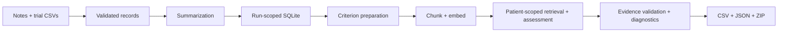

# Architecture

The UI and CLI load the same validated input records and invoke the same LangGraph workflow.

## Patient identity

A Summary contains its patient ID, original note, summary, and optional error together. Failed summarization retains the record, so later records cannot shift position. SQLite uses a composite run ID and patient ID primary key.

## Retrieval

Every run receives an independent persistent Chroma directory. Embeddings are provided explicitly with RETRIEVAL_DOCUMENT or RETRIEVAL_QUERY, avoiding mutable task modes. Query metadata always filters by patient ID. Reverse retrieval uses the same filter.

Embedding responses must contain one finite, nonzero vector per input and must retain a consistent dimension. Request batches contain at most 64 chunks.

## Model integration

The Provider interface defines summarization, criterion preparation, embeddings, assessment, and cleanup. GeminiProvider uses structured Pydantic response schemas and retries transient API status codes with a bounded backoff. Imports perform no API calls, tuning, UI launch, or database initialization.

Criteria retain their trial/name identity and inclusion/exclusion type. Model-generated clarification cannot replace that identity. Each assessment handles one patient and one criterion and provides a concise justification with quoted evidence.

## Failure behavior

Per-patient summarization failures and per-criterion model failures produce Unknown results with error metadata. Empty or unsupported evidence cannot support Yes or No. Infrastructure failures mark the run as failed and stop processing. Diagnostic failures retain the assessment and mark the affected CSV row.

Runs are unique, so a retry starts a new directory. Database upserts within a run are transactional. Readers receive artifacts only after the pipeline finishes exporting. Failed runs retain their status manifest and any diagnostic state written before failure.

## UI and artifacts

The UI accepts CSV/TXT notes and multiple criteria CSVs. It displays a compact review table, full summaries, alignment diagnostics, storage records, chunks, progress, and CSV/ZIP downloads. Keys are per-request client inputs or environment configuration, with no process-global environment mutation.

Generated outputs may contain the full uploaded notes. They are local application artifacts and are excluded from Git. The default server binds to localhost and does not create a public sharing link. Multi-user deployment needs separate access controls.
